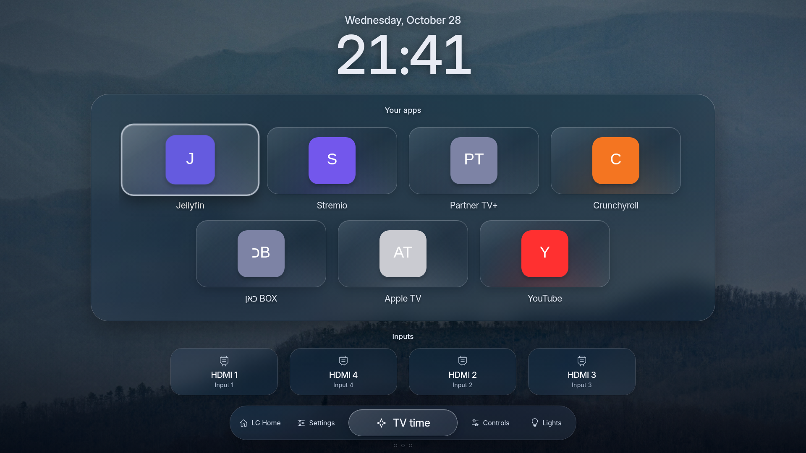
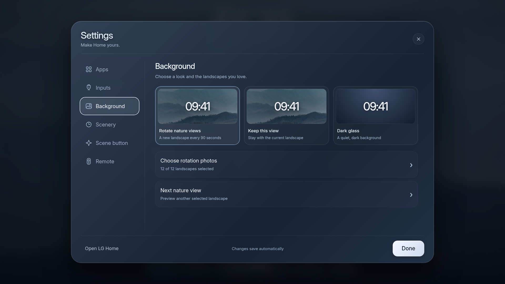
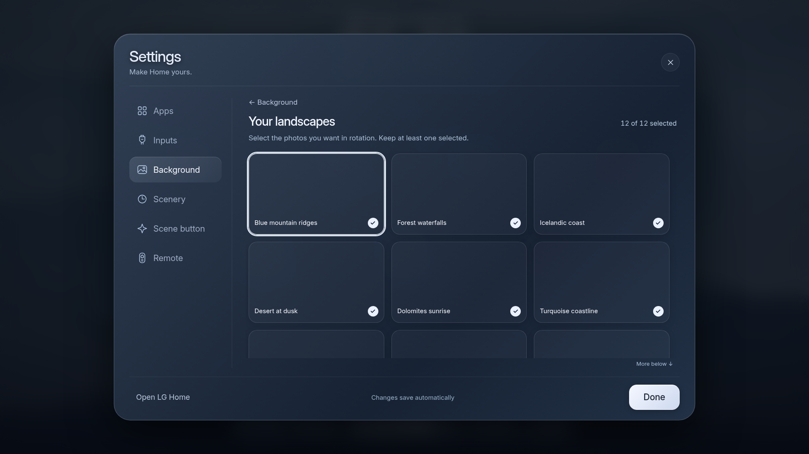
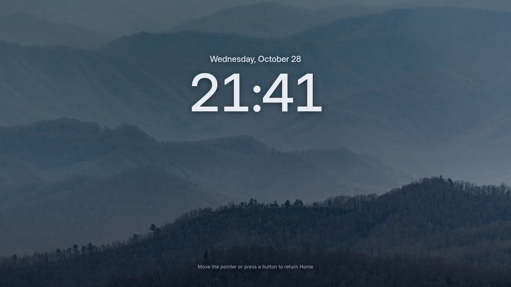
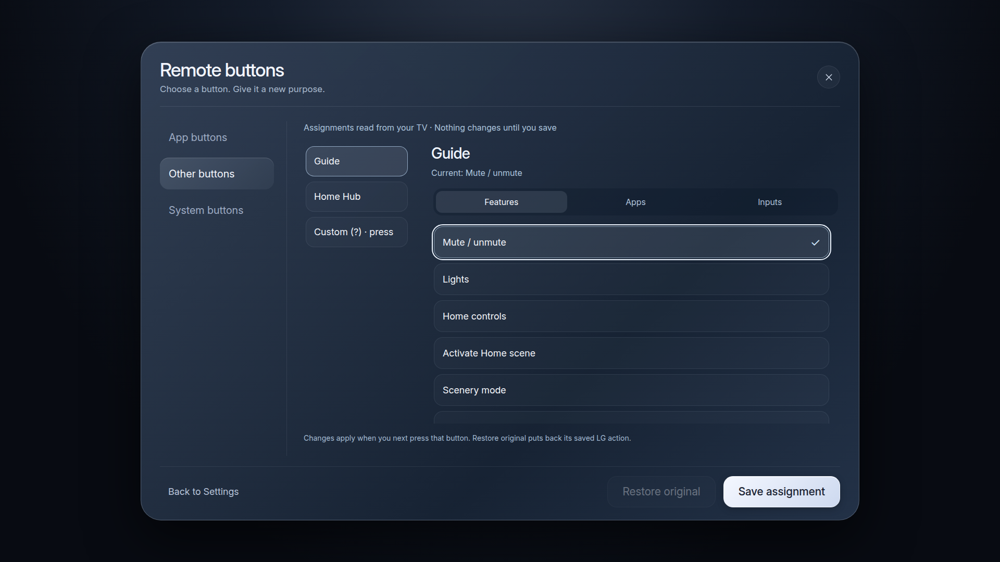
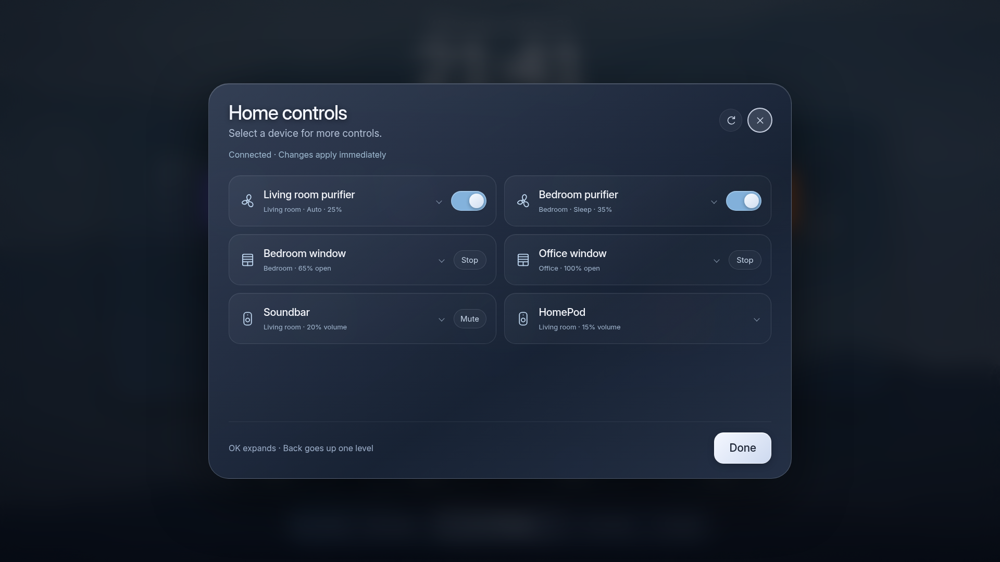
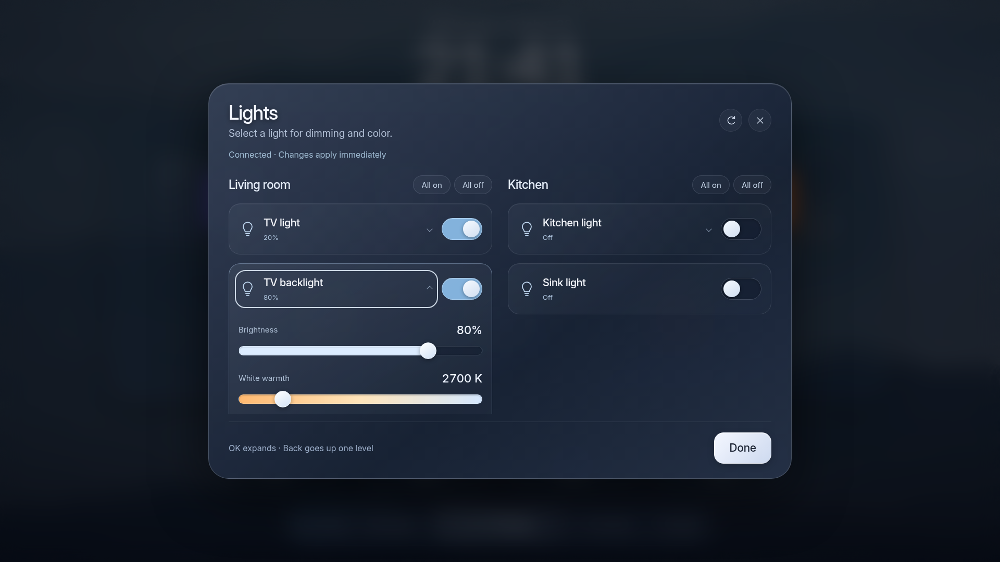

# Quiet Home for LG webOS

## No firmware flashing or persistent root

The launcher UI runs through LG's official Developer Mode: **no root is needed to install or use the ordinary app, and no firmware is flashed or modified**. The optional native default-Home step is separate: it uses **one-time administrator execution** to add one profile link. It leaves no persistent root installation, root server or background Home watcher. This distinction matters; making it the system default was not a privilege-free operation.



A centered, nature-backed Home screen with glass-style app tiles, inputs, a large clock, remote shortcuts and optional Home Assistant controls.

This is the shareable source of a personal customization developed on a **2026 LG G6, software 43.21.79, webOS 26 / internal SDK 11.2.0**. It includes the finished 0.10.0 UI and the bounded scripts used to make it the native default Home. It is a launcher, not a replacement operating system. Compatibility on a second TV is not established.

## What is included

- Favorite apps and HDMI inputs, with immediate remote navigation and cursor focus.
- A six-category Settings sidebar and a three-column nature-photo picker.
- Twelve credited 4K nature photographs, offline rotation and cached glass reflections.
- Scenery mode after 30 seconds, or three Back presses from Home. Three small dots fill as you press; the first navigation/OK/pointer action returns Home safely.
- A small LG Home tile to visit the original interface.
- An editor for native app shortcuts, Guide, Home Hub and exposed custom-button actions, with explicit Save and Restore original.
- An optional one-shot Mute helper, a TV time scene, and compact Home Assistant device controls that expand for dimmers, presets, shutter position and volume.
- Native-Home setup/probe/restore scripts, policy/browser tests and rollback instructions.

## Start here

```sh
git clone https://github.com/Omerhg/quiet-home-webos.git
cd quiet-home-webos
npm ci
npm run build
npm run preview
```

Use Node.js 22+ and Python 3. Preview opens at `http://127.0.0.1:8765`; stop it with Ctrl+C. No account or Home Assistant connection is required. App tiles use original monograms in this public version rather than redistributed proprietary app artwork.

1. Follow [INSTALL.md](docs/INSTALL.md) to enable Developer Mode, build and test the launcher as an ordinary app.
2. Run `npm run inspect:tv -- --device friend-tv` for a read-only SDK check. If considering native default Home, review [NATIVE-HOME.md](docs/NATIVE-HOME.md) and its protected baseline checks. Developer Mode alone does **not** grant this access. Even the native `probe` uses temporary administrator execution.
3. Set up optional [remote shortcuts](docs/REMOTE.md) and [Home Assistant](docs/HOME-ASSISTANT.md).
4. Keep [ROLLBACK.md](docs/ROLLBACK.md) handy. LG Home is retained, and the native Home override is a single owned profile link.

**Another TV, or an assistant refusing the native step?** Read [compatibility troubleshooting](docs/COMPATIBILITY.md). CS5 software 43.21.77 is not rejected just for differing from 43.21.79: the native gate checks SDK 11.2.0 and Home profiles. A matching SDK still does not establish compatibility; the ordinary app and LG Quick Access are separate options.

**Adapting it with an AI agent?** Give it [the porting instructions](docs/PORTING-FOR-AGENTS.md): identify the device, research the appropriate one-shot route, add explicit version/profile validation, test and preserve rollback. The guide includes an owner prompt and evidence requirements for a new model.

## A look inside

All screenshots below come from the sanitized public app with original monogram tiles and synthetic demo settings. They contain no live device or account data.

| Settings | Your landscapes |
| --- | --- |
|  |  |

| Scenery mode | Remote button editor |
| --- | --- |
|  |  |

| Compact smart-home controls | Light adjustments |
| --- | --- |
|  |  |

Device rows reveal more options on demand: [expanded controls](docs/images/controls-expanded.png).

Recreate these locally with `npm run screenshots` after installing Playwright Chromium. A demo scene appears in the screenshots; HA remains disabled in a fresh build.

## Copyright and disclaimer

This is an independent community project, **not affiliated with or endorsed by LG, Apple, Home Assistant or any app publisher**. Product names and trademarks belong to their respective owners. Original code is MIT-licensed; photography and fonts retain their own licenses and credits. This repository does not grant rights to third-party branding or proprietary app artwork, and includes no LG firmware or system binaries.

The software is provided **as is, without warranty**, under the license terms. Device-specific compatibility and recovery must be checked on your own authorized hardware. See [LICENSE](LICENSE), [THIRD-PARTY-NOTICES.md](THIRD-PARTY-NOTICES.md) and [verification limits](docs/VERIFICATION.md).

## Changes and publication

Suggestions are welcome through pull requests. **The owner must explicitly approve every push to this public repository and any merge.** Assistants and automation must prepare a reviewable local result before requesting publication approval; development instructions do not waive this requirement. See [CONTRIBUTING.md](CONTRIBUTING.md), [AGENTS.md](AGENTS.md) and [CODEOWNERS](.github/CODEOWNERS).

## Public defaults and private builds

The repository contains **no usable account tokens, webhook capabilities, SSH keys, TV pairing credentials, personal network addresses, account files, or private browser shortcuts**. Home Assistant is disabled by default. Set up your own optional credentials/capabilities under the ignored `.local/` directory.

```sh
mkdir -p .local
cp config/local.example.json .local/config.json
# Edit your own HA origin, entity IDs and TV time roles first.
python3 -I scripts/configure_ha.py
npm run package
```

Private configuration is copied only into ignored `.build/` and `dist/` output. Never share those personalized packages, `.local/` or CLI connection files. The tracked app remains sanitized. Read [SECURITY.md](SECURITY.md) and the [privacy boundary](docs/PRIVACY.md).

## Key limits

- The native Home operation was verified on the original G6. The shareable helper is tested with simulated services, not on another TV; its probe refuses differing SDK/profile baselines.
- Root execution is temporary during that operation. No persistent root service, Homebrew Channel, boot hook or computer-side Home watcher is installed by it.
- Developer Mode must remain active and be renewed. If it expires, LG may remove developer apps.
- Arbitrary physical-key remapping is not provided. AI, power and navigation keys keep LG handling. LG may reset app shortcuts after a restart or regional update. Expanded remote settings have browser/service simulations; physical button routing depends on the recipient's device.
- The optional Mute helper's ordinary-app input access was verified on the original firmware only.
- A native firmware screensaver or panel-protection feature can still take priority over the app's Scenery view.

## Build and check

```sh
npm run check
npm run test:policy
npm run test:ha
npx playwright install chromium
npm test
npm run package
npm run package:mute
npm run scan
```

If using an existing Chrome install, set `PLAYWRIGHT_CHROME_PATH` for the test run. Normal tests use Playwright's Chromium. Generated packages go to `dist/`. The first public source contains 40 browser checks, 19 native/remote policy checks and 17 HA policy checks; it also validates generated configuration and installer boundaries. See [VERIFICATION.md](docs/VERIFICATION.md) for the distinction between on-TV evidence and the public export.

The app ID in this public version is `com.quiet.home`, with helper `com.quiet.mute`. This differs from the original personal installation; all included scripts and profile data use the public IDs consistently. Do not mix packages and setup scripts from different copies.

Original code: [MIT](LICENSE). Photography, fonts, trademarks and research credit: [THIRD-PARTY-NOTICES.md](THIRD-PARTY-NOTICES.md).
